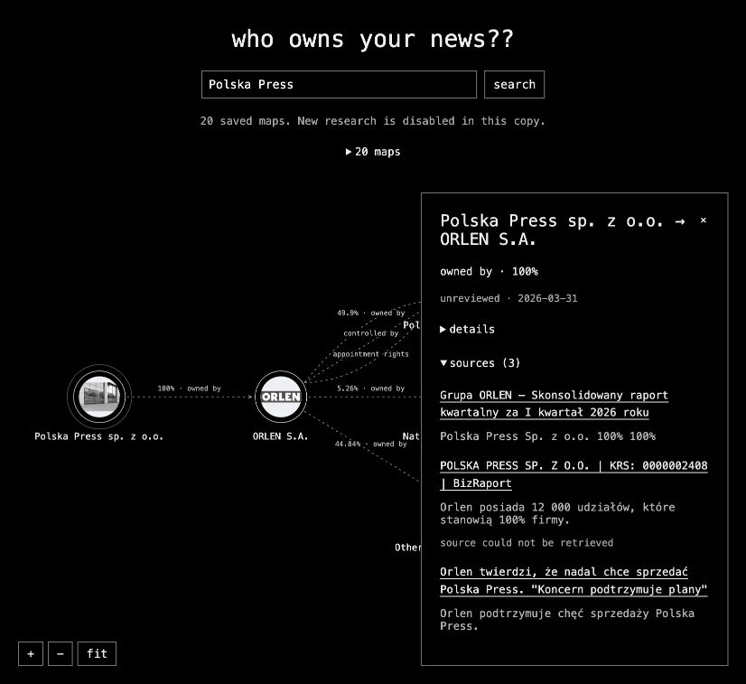

# 3DOM2

**Who owns your news?**

3DOM2 researches the organisations behind a publication and turns proposed ownership and control relationships into an interactive graph. Each connection carries source links, short supporting passages and dates, so readers can inspect how the map was assembled.

[Original demo](https://3dom2.dianam.uk/) · [Architecture](docs/architecture.md) · [Development history](docs/project-history.md) · [Contributing](CONTRIBUTING.md)

The application uses plain HTML, CSS and browser JavaScript, a local Node.js server, and an optional Cloudflare Workers backend. This public release contains the application recovered from the September–October 2026 project, with portable deployment settings and an MIT licence.



The preview shows a dated, unreviewed example; source details and dates remain visible alongside the graph.

## What you can explore

- Search publications by name or alias and follow their parent organisations through a bounded graph.
- Distinguish ownership, parent companies, publishing services, management, control and appointment rights.
- Click entities and connections to inspect descriptions, evidence, source links and observation dates.
- Pan and zoom the SVG map; view available Wikimedia images and their attribution.
- Save research, download source-linked JSON, and approve or reject individual relationships in personal research maps.
- Browse 20 prepared maps without an AI account or a research request.

The collection includes 17 news publications and three academic journals, including Polska Press, The Guardian, Reuters, BBC, the Financial Times, Nature, Science and The Lancet. Its September 2026 snapshots contain **131 proposed connections and 86 distinct evidence URLs**. Every connection remains pending human review. These are dated examples; published examples are read-only.

## Try it locally

Requires **Node.js 22 or later**. The local server and tests use Node's built-in modules; browsing the examples needs no dependency installation or API key.

```sh
git clone https://github.com/di4rm4d4/3dom2.git
cd 3dom2
npm start
```

Open [localhost:8765](http://localhost:8765). Search for `Polska Press`, `Guardian`, `NYT` or another bundled publication, or open the map list. Shared links reopen the corresponding saved example.

New research is disabled in this release's default frontend and hosted configuration. Browsing the prepared maps makes no research API calls; entity images may still load from Wikimedia.

## Enable new research

For the local app, change `liveResearch` to `true` in `public/data/catalog.json`, then choose a provider:

**Existing Codex sign-in.** Install and authenticate the Codex CLI, then run `npm start`. The server looks for `CODEX_BIN`, the desktop app's bundled CLI, or `codex` on your path. Research uses that account's allowance. Credentials stay with your existing sign-in.

**OpenAI API.** Copy the template, add your own server-side key to the ignored file, and start with environment-file loading:

```sh
cp .env.example .env
# Edit .env locally, then:
npm run start:env
```

The template selects the same model as the original hosted adapter. Set `OPENAI_MODEL` to a model available to your account that supports web search and structured outputs. The unconfigured local API adapter otherwise defaults to `gpt-6-astra`. API usage is billed to your account.

The browser requests three relationship levels; the API accepts one to four. Validation caps graphs at 24 entities and 48 edges, removes invalid references and disconnected entities, and leaves unresolved endpoints visible. Each new relationship starts as `pending`. Local research allows one active job, requests cancellation after eight minutes, and can reuse matching results less than 24 hours old.

The local server binds to loopback and is intended for personal use. Use the Worker backend for public hosting.

## Host your own copy

The public copy has no Cloudflare account ID, production domain bindings or API keys. The included GitHub workflow runs tests and a deployment dry run.

```sh
npm ci
npm run dev:cloud
```

For deployment, authenticate Wrangler with your own account, choose an available Worker name in `wrangler.jsonc`, and run `npm run deploy`. The default deployment serves prepared maps with paid research disabled.

To enable hosted research, add your Worker's own secret interactively:

```sh
npx wrangler secret put OPENAI_API_KEY
```

Set `RESEARCH_ENABLED` to `"true"` in `wrangler.jsonc` and `liveResearch` to `true` in `public/data/catalog.json`, then redeploy. Configure any custom domain in your own Cloudflare account.

One persistent Durable Object enforces these hosted limits across visitors and Worker domains:

| Limit | Default |
| --- | --- |
| Site-wide research starts | 5 per UTC day |
| Research starts per IP | 2 per UTC day |
| Lifetime research starts | 20, until the configured ceiling is raised |
| Concurrent research | 1 |
| Output tokens per request | 6,000 |
| Built-in tool calls per request | 12 |
| Deadline | Cancellation requested after 8 minutes |

Failed and cancelled starts count because they may have incurred charges. Uncertain paid starts are not automatically retried. These limit usage, not an exact currency amount or hosting charges. Setting `RESEARCH_ENABLED` to `"false"` stops new hosted research while prepared maps remain available.

Personal hosted maps belong to an anonymous browser session retained for 30 days. Download JSON for longer retention; clearing the session cookie loses access to those personal maps. Keep the Durable Object during ordinary deployments: it holds usage counters and personal research.

## Evidence and limitations

The graph shows proposed relationships supported by cited sources. It does not score political bias, infer editorial direction from a shareholder, or establish independence when a chain ends.

The research prompt prefers official ownership pages, annual reports and company records, distinguishes publishing from equity ownership, and asks for recent transfers and conflicting dates. Structural validation cannot determine whether a source proves the claim.

The local checker retrieves eligible public HTML and checks for matching excerpts. A matching passage or a reachable page is not factual verification; PDF text is not independently extracted. The hosted adapter leaves citations marked `not_checked` for human review. Sources can be blocked, stale or incomplete. Observation dates and research dates serve different purposes and are preserved separately.

The prepared maps demonstrate the workflow. They are not evidence of comprehensive coverage or user adoption.

## Project layout

| Path | Purpose |
| --- | --- |
| `public/` | Minimal interface, SVG graph, evidence drawers and prepared maps |
| `server.mjs` | Local API, research jobs, snapshots and review revisions |
| `lib/research.mjs` | Local Codex and OpenAI API adapters |
| `lib/research-prompt.mjs` | Shared research instructions |
| `lib/schema.mjs` | Structured contract and graph normalization |
| `lib/public-web.mjs` | Public-source checks and Wikimedia image resolution |
| `worker/` | Hosted API, limits, background jobs and session storage |
| `scripts/build-catalog.mjs` | Explicit batch generation of the collection |
| `test/` | Graph, API-response, catalog and Worker regression tests |
| `runtime/` | Ignored local maps and temporary research files |

The catalog builder intentionally uses the local Codex provider and removes `OPENAI_API_KEY` from its process. Running it consumes the local account's allowance; it is never part of tests or CI.

## Validation and contributions

```sh
npm test
# Optional Worker bundle check, after npm ci:
npm run check:deploy
```

Tests use fixtures and mocked providers without starting paid research. See [release validation](VALIDATION.md), [historical checks](docs/validation-history.md), and [CONTRIBUTING.md](CONTRIBUTING.md).

## Licence

Original code and documentation are available under the [MIT licence](LICENSE). Third-party excerpts and images retain their own rights and attribution; see [NOTICE](NOTICE).
