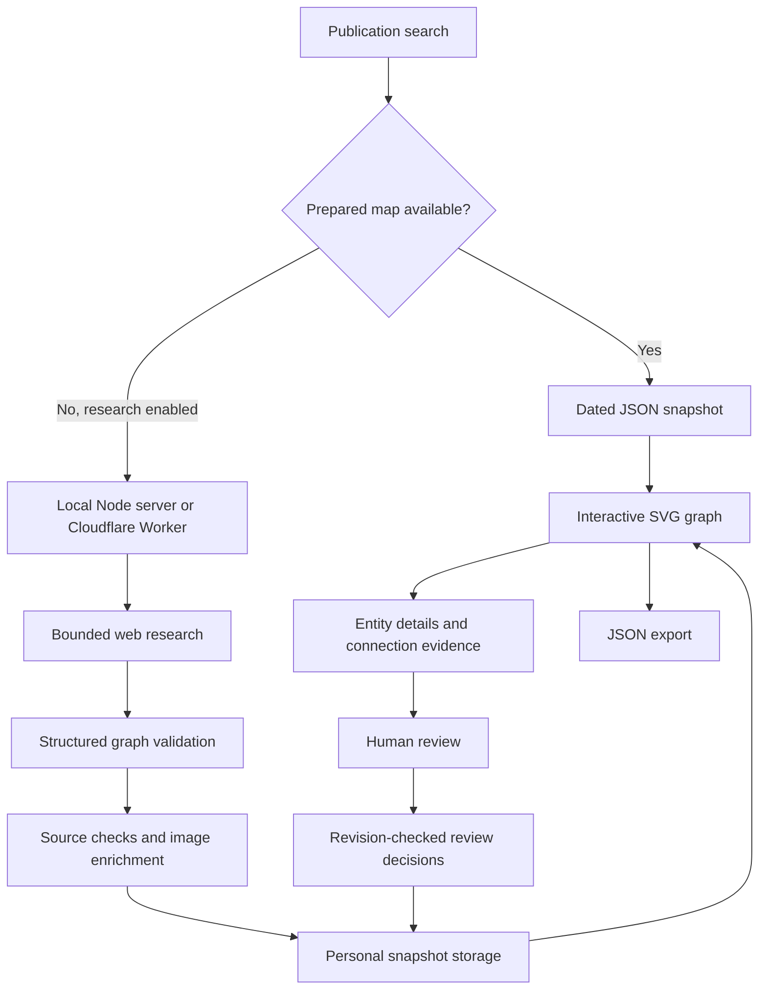

# How 3DOM2 works

## Research contract

The researcher proposes entities, directed connections and unresolved questions. Connections point from a subject to its owner, publisher, parent, manager, controller or appointing authority. Each includes a relationship type, optional percentage, observation date, explanation and evidence records.

The host validates identifiers and URLs, filters invalid edges and unsupported references, removes disconnected entities, and applies depth and size bounds. It owns review state and timestamps: model output cannot approve its own claims. Multiple relationship types between the same entities can coexist.

The prompt distinguishes ownership from publishing and appointment rights, asks for recent transfers and local-language sources, and requires explicit stopping points when evidence or depth is exhausted.

## Local execution

The Node server stores personal maps in ignored `runtime/maps/`. It uses a local Codex sign-in or a server-side OpenAI key. The Codex researcher runs read-only with shell and file-edit tools disabled; the host handles persistence.

The citation checker restricts public destinations, pins resolved addresses, bounds retrieval and checks whether short excerpts appear in HTML. Reachability and excerpt matching are recorded separately from human judgment. PDFs can be reachable without independently checked text.

The server checks host, origin and a same-origin mutation token. Review requests carry the current graph revision to prevent silent overwrites from simultaneous edits.

## Hosted execution

The Worker serves assets and JSON routes. A SQLite Durable Object coordinates research, site/IP/lifetime counters, background alarms, cancellation and personal map storage. A secure anonymous browser-session cookie scopes personal maps and review decisions. Daily IP quotas use keyed daily hashes.

A paid start reserves allowance before contacting the provider. An uncertain response leaves a cooldown or locked active slot rather than immediately retrying a request that may already have been billed. Background jobs can finish after a tab closes. The hosted adapter leaves citation checks as `not_checked`.

## Prepared examples

The catalog is served directly from `public/data/`. Opening a prepared map creates no research job. It remains read-only, preserves dates and evidence, and labels every proposed relationship pending review. Private runtime maps and credentials are excluded from the release.

Research proposes claims; validation checks their structure; human review assesses evidence. The graph makes the research inspectable while retaining its uncertainty.
